**[About](#about-me) · [Focus](#current-focus) · [Stack](#technology-stack) · [Projects](#featured-projects) · [Research](#research-and-publications) · [Achievements](#certifications-and-achievements) · [Stats](#github-statistics) · [Contact](#contact)**

## Hi, I'm Rheil

<table>
<tr>
<td width="300" valign="top">

</td>
<td valign="top">

I'm a Computer Science student at USTP Cagayan de Oro who builds practical software, and I write research when a problem needs a model instead of a guess. My work ranges from AI prompt tooling and desktop utilities to a published study on blood pressure transitions with its own web application.

I go by **RETL** online.

### About Me

- Computer Science student at the **University of Science and Technology of Southern Philippines (USTP), Cagayan de Oro**
- Python developer who also builds for the web with JavaScript, TypeScript and React
- Published researcher, with a study that pairs a statistical model with a working web app
- Active beyond code, in leadership, public speaking, broadcasting and creative work

</td>
</tr>
</table>

## Current Focus

## Technology Stack

## Featured Projects

<table>
<tr>
<td width="50%" valign="top">

### PromptPilot
An AI prompt engineering workspace for creating, organizing, testing, comparing and optimizing prompts. It includes a prompt library, a playground, a side-by-side Compare Lab, version history and analytics.

`React` `TypeScript` `Vite` `Node.js` `Gemini API`

[View repository →](https://github.com/rheillunio2-byte/Prompt-Pilot)

</td>
<td width="50%" valign="top">

### SmartFileOrganizerPro
A Python desktop application that automatically organizes files into structured folders.

`Python`

Repository: `TODO — add link`

</td>
</tr>
<tr>
<td width="50%" valign="top">

### CommitQuest
A coding and debugging game with XP, achievements, hints and challenges.

Repository: `TODO — add link`

</td>
<td width="50%" valign="top">

### DayForm
A productivity and scheduling platform with schedule templates.

Repository: `TODO — add link`

</td>
</tr>
<tr>
<td colspan="2" valign="top">

### Blood Pressure Transition Modeling
My published research and its accompanying web-based application. The study models how blood pressure categories change over time, as a basis for hypertension prevention programs.

[Read the publication →](https://www.researchgate.net/publication/406513523_Modeling_Blood_Pressure_Transitions_Using_an_Integrated_Multistate_Markov_Chain-Logistic_Model_with_a_Web-Based_Application_Basis_for_Hypertension_Prevention_Programs) &nbsp;·&nbsp; Web app repository: `TODO — add link`

</td>
</tr>
</table>

### More on GitHub

| Repository | What it is |
|---|---|
| [CodeGuard-AI](https://github.com/rheillunio2-byte/CodeGuard-AI) | Python code reviewer using Bandit, Ruff and Google Gemini to flag security and quality issues |
| [SafeRoutePH](https://github.com/rheillunio2-byte/SafeRoutePH) | Disaster preparedness platform for Cagayan de Oro City with maps, emergency contacts and evacuation planning |
| [Logic-Lab](https://github.com/rheillunio2-byte/Logic-Lab) | Interactive digital logic simulator with circuits, gates and truth tables |
| [APIHub](https://github.com/rheillunio2-byte/APIHub) | Platform for discovering and testing free APIs, with an interactive playground |
| [Calcora](https://github.com/rheillunio2-byte/Calcora) | React and Vite calculator and math solver with step-by-step solutions |
| [Bug-Hunter-Simulator-GLITCHWILD](https://github.com/rheillunio2-byte/Bug-Hunter-Simulator-GLITCHWILD) | Interactive debugging game with missions, XP and achievements |

## Research and Publications

**Modeling Blood Pressure Transitions Using an Integrated Multistate Markov Chain–Logistic Model with a Web-Based Application: Basis for Hypertension Prevention Programs**

Published research that combines a multistate Markov chain with logistic modeling to study how blood pressure states change, and delivers the model through a web-based application.

[Read on ResearchGate →](https://www.researchgate.net/publication/406513523_Modeling_Blood_Pressure_Transitions_Using_an_Integrated_Multistate_Markov_Chain-Logistic_Model_with_a_Web-Based_Application_Basis_for_Hypertension_Prevention_Programs)

## Certifications and Achievements

**Academic distinctions:** <!-- TODO: list your actual awards, with issuer and year --> `TODO — add distinctions`

## GitHub Statistics

## Contribution Activity

## Contact

- Portfolio: [retl.my.canva.site](https://retl.my.canva.site/)
- LinkedIn: [Rheil Evans Lunio](https://www.linkedin.com/in/rheil-evans-lunio-039560423/)
- Facebook: [rheil.evans](https://www.facebook.com/rheil.evans)
- Instagram: [@i_onre](https://www.instagram.com/i_onre/)
- TikTok: [@i_onremf](https://www.tiktok.com/@i_onremf)
- Research: [ResearchGate publication](https://www.researchgate.net/publication/406513523_Modeling_Blood_Pressure_Transitions_Using_an_Integrated_Multistate_Markov_Chain-Logistic_Model_with_a_Web-Based_Application_Basis_for_Hypertension_Prevention_Programs)

