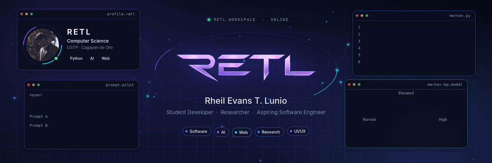
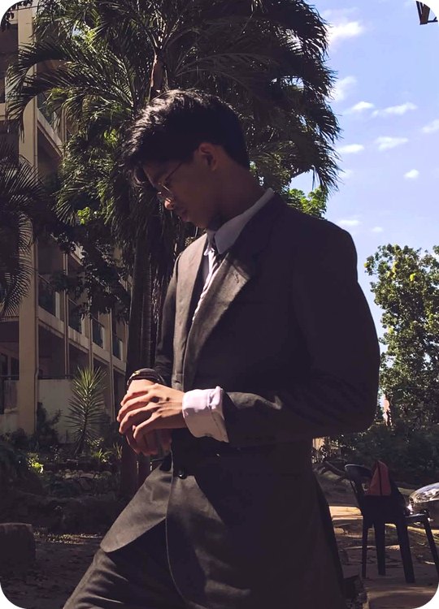

**[About](#about-me) · [Focus](#current-focus) · [Stack](#technology-stack) · [Projects](#featured-projects) · [Research](#research-and-publications) · [Achievements](#certifications-and-achievements) · [Stats](#github-statistics) · [Contact](#contact)**

## Hi, I'm Rheil

<table>
<tr>
<td width="300" valign="top">

</td>
<td valign="top">

I'm a Computer Science student at USTP Cagayan de Oro who builds practical software, and I write research when a problem needs a model instead of a guess. My work ranges from AI prompt tooling and desktop utilities to a published study on blood pressure transitions with its own web application.

I go by **RETL** online.

### About Me

- Computer Science student at the **University of Science and Technology of Southern Philippines (USTP), Cagayan de Oro**
- Python developer who also builds for the web with JavaScript, TypeScript and React
- Published researcher, with a study that pairs a statistical model with a working web app
- Active beyond code, in leadership, public speaking, broadcasting and creative work

</td>
</tr>
</table>

## Featured Projects

  

<table>
<tr>
<td width="50%" align="center" valign="top">

### PromptPilot

AI prompt workspace with a library, playground, comparison tools, and analytics.

<a href="https://github.com/rheillunio2-byte/Prompt-Pilot">**View Project →**</a>

</td>
<td width="50%" align="center" valign="top">

###  SmartFileOrganizerPro

Desktop tool that automatically sorts files into organized folders.

<a href="https://github.com/rheillunio2-byte/SmartFileOrganizerPro">**View Project →**</a>

</td>
</tr>
<tr>
<td width="50%" align="center" valign="top">

###  CommitQuest

Gamified coding challenges with XP, hints, and achievements.

<a href="https://github.com/rheillunio2-byte/Commit-Quest">**View Project →**</a>

</td>
<td width="50%" align="center" valign="top">

###  DayForm

Scheduling platform with customizable templates for daily planning.

<a href="https://github.com/rheillunio2-byte/DayForm">**View Project →**</a>

</td>
</tr>
</table>

  Designed and developed by <strong>RETL</strong> · Turning ideas into projects.

### Blood Pressure Transition Modeling
My published research and its accompanying web-based application. The study models how blood pressure categories change over time, as a basis for hypertension prevention programs.

[Read the publication →](https://www.researchgate.net/publication/406513523_Modeling_Blood_Pressure_Transitions_Using_an_Integrated_Multistate_Markov_Chain-Logistic_Model_with_a_Web-Based_Application_Basis_for_Hypertension_Prevention_Programs) 

</td>
</tr>
</table>

### More on GitHub

| Repository | What it is |
|---|---|
| [CodeGuard-AI](https://github.com/rheillunio2-byte/CodeGuard-AI) | Python code reviewer using Bandit, Ruff and Google Gemini to flag security and quality issues |
| [SafeRoutePH](https://github.com/rheillunio2-byte/SafeRoutePH) | Disaster preparedness platform for Cagayan de Oro City with maps, emergency contacts and evacuation planning |
| [Logic-Lab](https://github.com/rheillunio2-byte/Logic-Lab) | Interactive digital logic simulator with circuits, gates and truth tables |
| [APIHub](https://github.com/rheillunio2-byte/APIHub) | Platform for discovering and testing free APIs, with an interactive playground |
| [Calcora](https://github.com/rheillunio2-byte/Calcora) | React and Vite calculator and math solver with step-by-step solutions |
| [Bug-Hunter-Simulator-GLITCHWILD](https://github.com/rheillunio2-byte/Bug-Hunter-Simulator-GLITCHWILD) | Interactive debugging game with missions, XP and achievements |

## Research and Publications

**Modeling Blood Pressure Transitions Using an Integrated Multistate Markov Chain–Logistic Model with a Web-Based Application: Basis for Hypertension Prevention Programs**

Published research that combines a multistate Markov chain with logistic modeling to study how blood pressure states change, and delivers the model through a web-based application.

[Read on ResearchGate →](https://www.researchgate.net/publication/406513523_Modeling_Blood_Pressure_Transitions_Using_an_Integrated_Multistate_Markov_Chain-Logistic_Model_with_a_Web-Based_Application_Basis_for_Hypertension_Prevention_Programs)

## Certifications and Achievements

**Academic Distinctions:**  
To view my academic awards, honors, and distinctions, visit my [Personal Portfolio](https://retl.my.canva.site/). Navigate to **About → Educational Background** to see the complete list of my Academic Distinctions, including their respective issuers and years.

## Contact

- Portfolio: [retl.my.canva.site](https://retl.my.canva.site/)
- LinkedIn: [Rheil Evans Lunio](https://www.linkedin.com/in/rheil-evans-lunio-039560423/)
- Facebook: [rheil.evans](https://www.facebook.com/rheil.evans)
- Instagram: [@i_onre](https://www.instagram.com/i_onre/)
- TikTok: [@i_onremf](https://www.tiktok.com/@i_onremf)
- Research: [ResearchGate publication](https://www.researchgate.net/publication/406513523_Modeling_Blood_Pressure_Transitions_Using_an_Integrated_Multistate_Markov_Chain-Logistic_Model_with_a_Web-Based_Application_Basis_for_Hypertension_Prevention_Programs)

